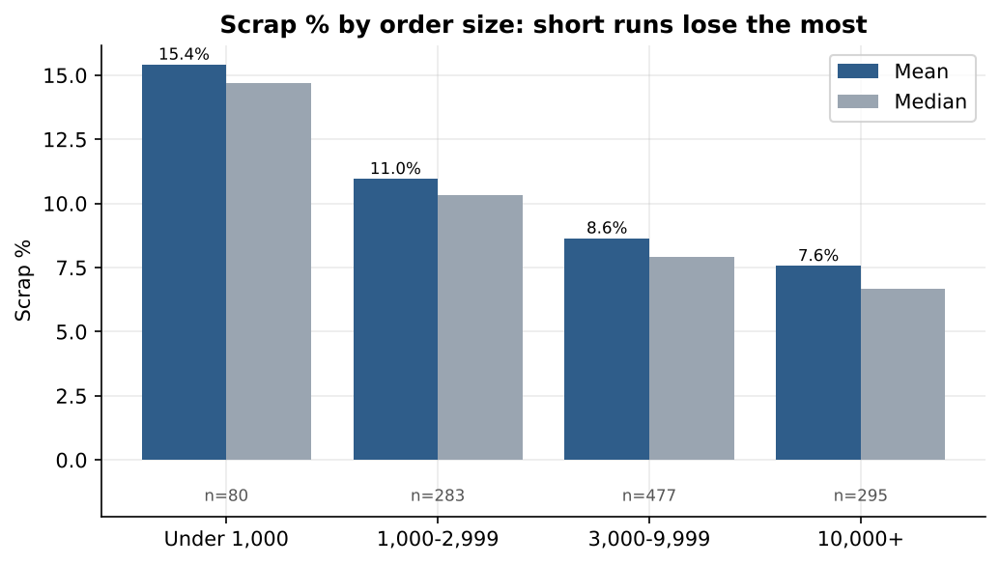

# Case 1 - Scrap in the plant

> **Synthetic case.** OrygamiBox S.A. is a fictional folding-carton manufacturer. The data was generated with AI and contains deliberate errors, duplicates and missing values.

| | |
|---|---|
| **Problem** | The plant discards more board than expected and nobody knows where it comes from. |
| **Question** | *"In which products, machines or shifts do we lose the most board, and how much does it cost?"* (asked by the plant manager) |
| **Finding** | Scrap is **7.9%** of the units released to the floor, about **$113k of board in 24 months (2.8% of revenue)**. Short orders lose twice as much as long ones (median 14.7% vs 6.7%), foil and emboss add 2 to 5 points, and one offset press on the night shift runs about 50% above the rest. The flat 5% scrap allowance used in quotes is **$48k** short of reality. |
| **Recommendation** | Replace the flat 5% allowance with a *fixed + variable* allowance by order size and finish; check press B on the night shift; make the scrap reason mandatory. |

**Tools:** Python (pandas) for cleaning and analysis, spreadsheet for the report and dashboard.
**Statistics used:** mean vs median, distribution, IQR outlier rule, group comparison, simple linear fit.

## What I did

1. **Cleaned the raw data** (`pipelines/clean_data.py`). Many issues in the tables used here, for example 50 duplicate stage records, 12 rows with end time before start time, 35 sign errors and 612 scrap records without a reason. Every decision is in the cleaning log (see the report for the before/after table).
2. **Built an order-level table:** units released, scrap units, scrap % and scrap cost (scrap units x material cost per piece).
3. **Looked at the shape of the data first.** Scrap % is right-skewed: the mean (9.4%) sits above the median (8.4%), and 50 orders are outliers above 18.4%.
4. **Compared groups:** order size, finish, board type, production stage, machine and shift.
5. **Controlled for order size** before blaming the finish: foil/emboss is worse inside every size band, so it is not only a short-run effect.
6. **Estimated the money** behind each recommendation.

## Key results

| Metric | Value |
|---|---|
| Orders analysed | 1,135 |
| Units released / scrapped | 10.96 M / 0.87 M |
| Weighted scrap rate | 7.9% |
| Mean / median scrap per order | 9.4% / 8.4% |
| Scrap cost (board only) | $113,260 (2.8% of revenue) |
| Top 10% of orders | 44% of scrap cost |
| Cost above the 5% quote allowance | $48,247 |



## Files

| File | What it is |
|---|---|
| `report.md` | Two-page report: method, findings, recommendations, limits |
| `dashboard/OrygamiBox_Case1_Scrap_Dashboard.xlsx` | Spreadsheet dashboard (formulas over the order data, 4 charts) |
| `analysis.py` | Analysis and charts (pandas, matplotlib) |
| `build_dashboard.py` | Builds the spreadsheet |
| `charts/` | PNG charts used in the report |
| `results.json` | Every number quoted in the report |

## How to reproduce

```bash
pip install -r requirements.txt
python appendix/generate_data.py     # optional: regenerates the synthetic raw data
python pipelines/clean_data.py       # raw -> clean + cleaning log
python case1_scrap/analysis.py       # numbers and charts
python case1_scrap/build_dashboard.py
```
