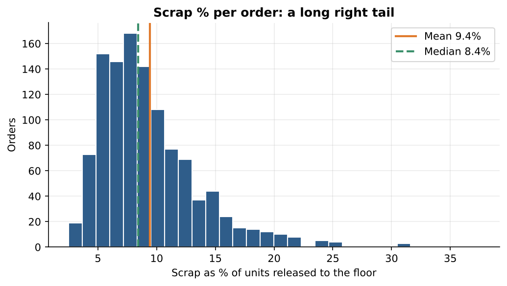
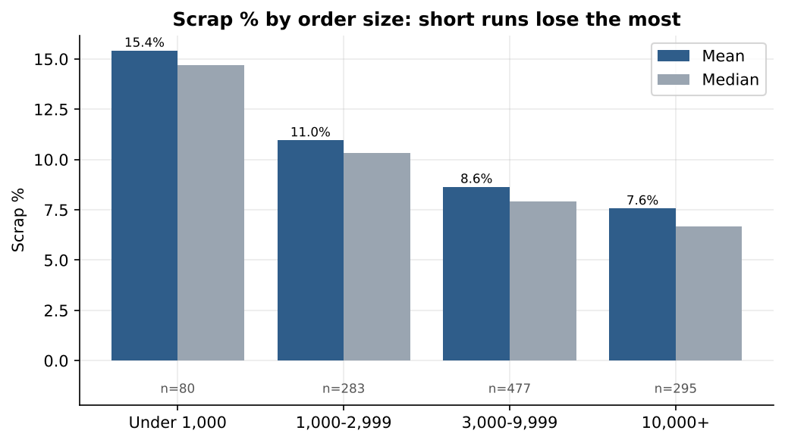
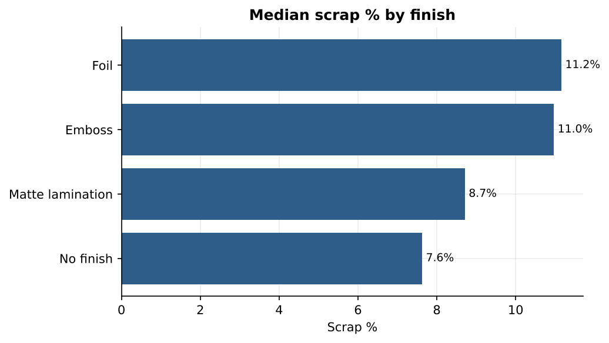
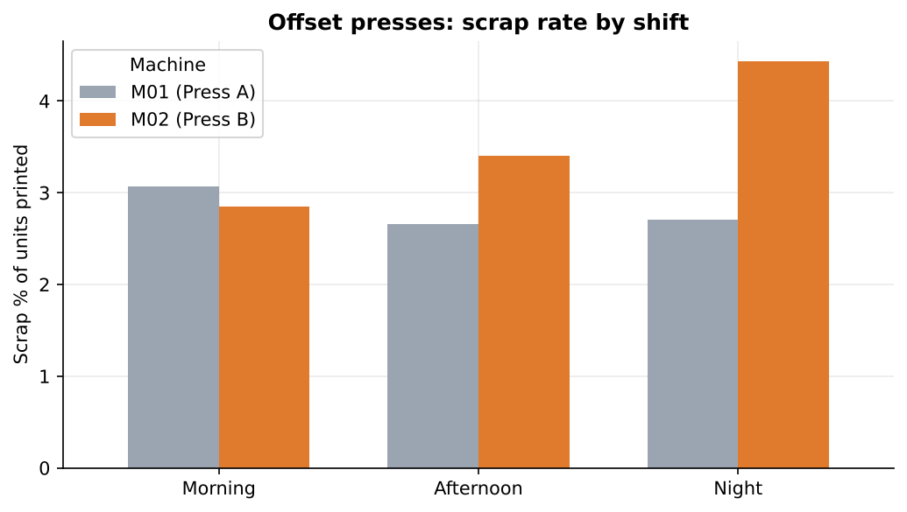

# Case 1 - Scrap in the plant: report

*OrygamiBox S.A. (fictional company, synthetic data) - period: January 2024 to December 2025*

## 1. Context and question

OrygamiBox makes custom folding cartons. Every order goes through printing, finishing (when requested), die-cutting, gluing and quality control. Pieces that fail at any stage are scrapped. The plant manager suspects the scrap is higher than it should be but cannot say where it happens or what it costs.

**Question:** in which products, machines or shifts do we lose the most board, and how much money is it?

## 2. Data and cleaning

Tables used: `production_stages` (one row per order and stage), `orders`, `quotes` (product attributes) and `order_costs` (material cost per piece). The raw files had the kinds of problems found in a real plant system. The main ones were:

| Table | Issue | Rows | Decision |
|---|---|---|---|
| production_stages | Exact duplicate rows | 50 | Dropped |
| production_stages | Orders that do not exist in `orders` | 4 | Dropped |
| production_stages | End time earlier than start time | 12 | Swapped the two times |
| production_stages | Negative quantities or scrap (sign errors) | 35 | Used the absolute value; checked that in - scrap = out |
| production_stages | Mixed labels and date formats (stage, machine, shift) | about 570 | Standardised |
| production_stages | Scrap with no reason recorded | 612 | Marked "Not recorded" (not guessed) |
| quotes | Duplicate quotes | 60 | Kept the first |
| quotes | Dimensions typed in cm instead of mm | 51 | Multiplied by 10 |

Result: 6,264 raw stage rows became 6,210 clean rows, and the quantity check (units in - scrap = units out) passes on every row. The full log is in `docs/cleaning_log.csv`.

## 3. Method

- **Scrap %** = scrap units / units released to the floor (first stage).
- **Scrap cost** = scrap units x material cost per piece. It only values the board, so it **understates** the true loss (the work already done on a scrapped piece is not counted).
- I looked at the distribution first, then compared groups, then checked whether an apparent effect survived controlling for order size.

## 4. Findings

**1. Scrap is real money, and it is concentrated.** Scrap is 7.9% of units released: about 865,000 pieces and $113k of board, 2.8% of revenue. The top 10% of orders hold 44% of the scrap cost.

**2. The average hides a long tail.** The mean scrap per order is 9.4% and the median is 8.4%. Fifty orders (4%) are outliers above 18.4%. Looking only at the mean would overstate a typical order and miss the extremes.

**3. Short orders lose much more, per unit.** A simple fit of scrap against quantity gives about **108 pieces of fixed scrap per order** (machine set-up) plus about 7.4% of the quantity. Fixed scrap weighs heavily on small orders.

| Order size | Orders | Median scrap % |
|---|---|---|
| Under 1,000 | 80 | 14.7% |
| 1,000-2,999 | 283 | 10.3% |
| 3,000-9,999 | 477 | 7.9% |
| 10,000+ | 295 | 6.7% |

A nuance: by **percentage** the short orders are worst, but by **dollars** the 10,000+ orders carry 62% of the scrap cost because they are so large. Orders below 3,000 units are 32% of orders and only 9% of scrap cost.

**4. Foil and emboss add 2 to 5 points, even at the same order size.**

| Order size | Foil / emboss (median) | Other finishes (median) |
|---|---|---|
| Under 1,000 | 18.5% | 13.8% |
| 1,000-2,999 | 14.2% | 9.8% |
| 3,000-9,999 | 10.0% | 7.7% |
| 10,000+ | 9.1% | 6.1% |

**5. One press on one shift stands out.** Offset press B (M02) scraps 4.4% of what it prints on the night shift, against 3.0% for the same press on other shifts and 2.7-3.1% for press A. This effect is real but small in money: about 18,500 extra pieces, roughly $2.4k over two years.

**6. The quoting model underestimates scrap.** Quotes include a flat 5% scrap allowance. Actual scrap cost exceeds that allowance by **$48k** over two years (43% of all scrap cost).

**7. Missing information.** 13% of scrapped pieces have no reason recorded. Of those that do, set-up (18%), material defects (18%) and operator error (16%) are the three largest.

## 5. Recommendations

| # | Recommendation | Why | Estimated impact | Effort |
|---|---|---|---|---|
| 1 | Replace the flat 5% allowance with a **fixed + variable** allowance by order size and finish (for example about 100 pieces fixed plus a percentage, higher for foil/emboss). | Fixed set-up scrap explains why small orders and special finishes lose more. | Up to **$48k** recovered over 24 months through quotes (a pricing fix, not a waste reduction). | Low |
| 2 | Review offset press B on the night shift (calibration, crew, maintenance). | Scrap rate 50% above the same press on other shifts. | About $2.4k over 24 months; also reduces quality risk. | Low |
| 3 | Make the **scrap reason mandatory** at each stage. Start a supplier quality check for material defects. | 13% of scrap has no reason, and material defects are 18% of the rest. | Not quantified; it makes the next analysis possible. | Low |

## 6. Limitations and next steps

- The data is synthetic, so the numbers show the method, not a real plant.
- The scrap cost counts only the board. Including printing and labour already invested would raise it.
- The press B effect comes from 139 night runs; it is worth confirming with more data before acting.
- Next step: check whether the high-scrap orders are also the ones delivered late (Case 3), and what scrap does to each client's margin (Case 4).
