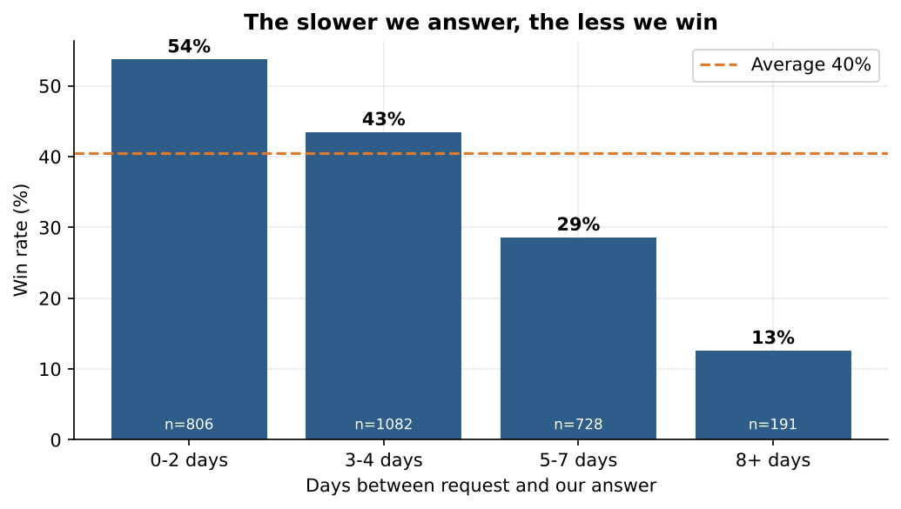

# Case 2 - Quote funnel

> **Synthetic case.** OrygamiBox S.A. is a fictional folding-carton manufacturer. The data was generated with AI and contains deliberate errors, duplicates and missing values.

| | |
|---|---|
| **Problem** | The company quotes a lot and wins little, and it is not clear where the sale is lost. |
| **Question** | *"Why do we lose quotes: price, response time or type of client?"* (asked by the sales director) |
| **Finding** | Win rate is **38%**, but it falls from **54%** when we answer in 0-2 days to **13%** when we take 8 or more. For e-commerce clients it drops from 61% to 2%. Price matters less than the team believes: the average markup of lost quotes is only 3.6 points above won ones. The CRM blames price in 47% of recorded loss reasons, but 45% of lost quotes have no reason at all. |
| **Recommendation** | Set a 4-day answer target (2 days for e-commerce and tech), give simple quotes a same-day price list, and make the loss reason mandatory. Do not cut prices first. |

**Tools:** BigQuery SQL (CTEs, window functions), Looker Studio dashboard, Python for charts.
**Statistics used:** win rates (proportions), correlation, comparison by segments, controlling for a second variable.

## What I did

1. **Cleaned the raw quotes in SQL** (`sql/01_clean_quotes.sql`): two date formats, mixed labels, dimensions in cm, 60 duplicate quotes (`ROW_NUMBER`), clients that do not exist (recovered from the order or marked UNKNOWN).
2. **Built the funnel by month** with a cumulative win rate and a moving average (`SUM() OVER`, `ROWS BETWEEN`).
3. **Tested response time** against win rate, in total and by sector.
4. **Tested price** by splitting quotes into four markup groups (`NTILE`) and checking each group again by speed.
5. **Compared sellers** (`RANK() OVER`) and checked how much of the difference is just speed.
6. **Checked client behaviour** with `LAG()`: does a lost quote lower the chance on the client's next one? It does not.
7. **Kept the claims modest.** This is observational data, so the report says what the numbers show and what they cannot prove.

## Key results

| Response time | Quotes | Win rate |
|---|---|---|
| 0-2 days | 806 | 54% |
| 3-4 days | 1,082 | 43% |
| 5-7 days | 728 | 29% |
| 8+ days | 191 | 13% |



## Files

| File | What it is |
|---|---|
| `report.md` | Report: method, findings, recommendations, limits |
| `sql/` | Six BigQuery queries (clean, funnel, response time, price, sellers, client gaps) |
| `looker_studio/` | Dashboard preview, the tables to connect, and setup instructions |
| `analysis.py` | Same numbers in pandas, plus the charts |
| `charts/`, `results.json` | Charts and every number quoted in the report |

## How to reproduce

The SQL is written for BigQuery. Load `data/raw/quotes.csv` as `orygamibox.raw_quotes` with **all columns as STRING**, and `data/clean/clients.csv` and `data/clean/orders.csv` as `orygamibox.clients` and `orygamibox.orders`. Then run the files in `sql/` in order. Details in `looker_studio/SETUP.md`.

```bash
python pipelines/clean_data.py      # raw -> clean
python case2_quotes/analysis.py     # pandas version of the numbers + charts
```
