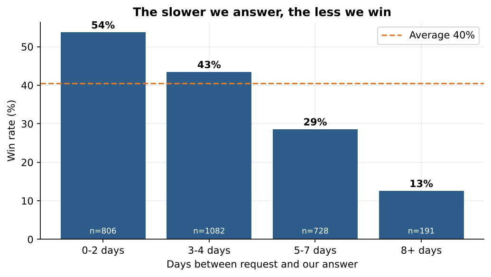
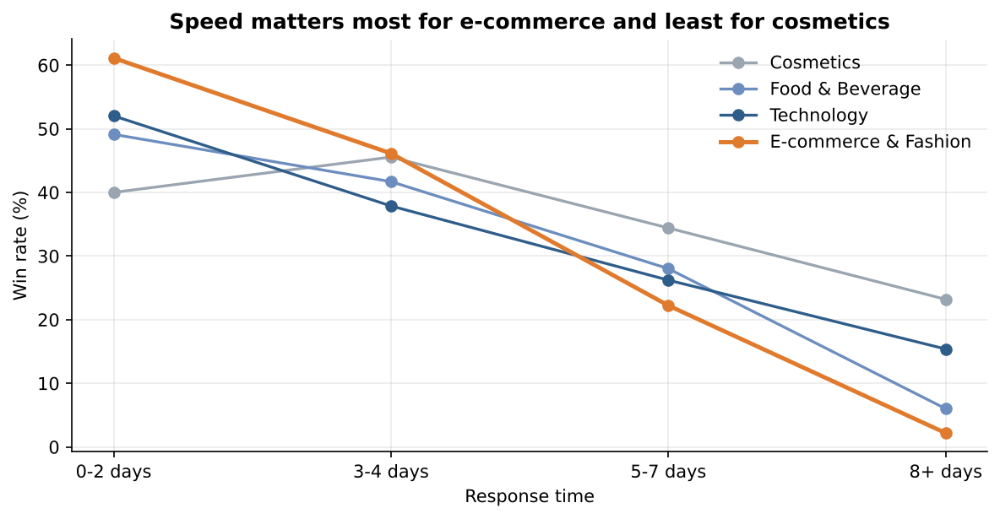
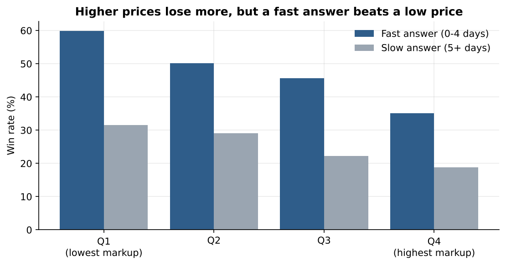
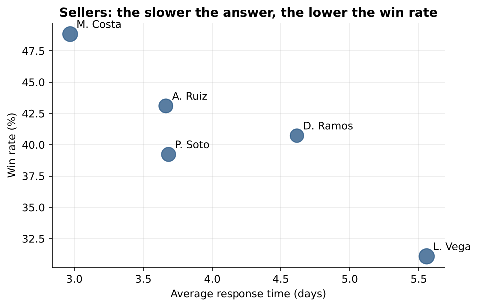

# Case 2 - Quote funnel: report

*OrygamiBox S.A. (fictional company, synthetic data) - quotes requested January 2024 to December 2025*

## 1. Context and question

Customers send a request (box size, board, printing, finish, quantity) and the sales team answers with a price. Many quotes are not won. The sales director believes the main reason is price.

**Question:** why do we lose quotes: price, response time or type of client?

## 2. Data and cleaning

Table: `quotes` (3,060 raw rows), joined with `clients` and `orders`. Cleaning was done in SQL (`sql/01_clean_quotes.sql`):

| Issue | Rows | Decision |
|---|---|---|
| Dates written as DD/MM/YYYY instead of YYYY-MM-DD | 247 | Parsed both formats |
| Inconsistent labels (board, printing, finish) | about 570 | Mapped to one spelling |
| Dimensions typed in cm instead of mm | 51 | Multiplied by 10 |
| Duplicate quotes (same content, different id) | 60 | Kept the first id |
| Client id that does not exist | 5 | 1 recovered from the order, 4 marked UNKNOWN |
| Lost quotes without a reason | 821 | Marked "Not recorded" |
| Missing response date (not won) | 148 | Left empty, excluded from speed analysis |

Result: 3,000 quotes. 2,954 are decided (won or lost) and the rest are still pending. For the speed analysis I use the 2,807 decided quotes that have a response date and a known client. I also checked that the SQL gives exactly the same cleaned table as the Python pipeline.

## 3. Findings

**1. The overall win rate is 38%, stable over time.** The monthly rate moves between 32% and 45% with no trend, so the problem is structural, not a recent drop.

**2. Response time is the strongest pattern.**

| Response time | Quotes | Win rate |
|---|---|---|
| 0-2 days | 806 | 54% |
| 3-4 days | 1,082 | 43% |
| 5-7 days | 728 | 29% |
| 8+ days | 191 | 13% |

The correlation between days to answer and winning is -0.23 (moderate, negative).

**3. It matters most for e-commerce and least for cosmetics.** E-commerce clients win 61% of quotes answered in 0-2 days and 2% of those answered in 8+ days (correlation -0.30). For cosmetics the fall is smaller (from 40-46% to 23%; correlation -0.16). Cosmetics buyers likely care more about finishes and quality than about speed.

**4. Price matters, but less than speed.** Lost quotes carry an average markup of 1.298 against 1.262 for won ones, a difference of 3.6 points. Splitting quotes into four markup groups, the win rate falls from 51% (lowest markup) to 30% (highest). But a **fast answer beats a low price**: a quote in the highest markup group answered within 4 days wins 35%, more than a quote in the lowest markup group answered slowly (31%).

*Caution:* part of the price effect is a client-size effect. Large clients get lower markups (1.18 on average, against 1.38 for small clients) and also win more (51% against 31%). That is why price was checked inside each speed group.

**5. Sellers differ, and speed explains a good part.** M. Costa answers in 3.0 days on average and wins 49%; L. Vega answers in 5.6 days and wins 31%. Cosmetics, which often need finishes and are slower to prepare, make up 46% of Vega's quotes, against 15-22% for the other sellers. Vega still ranks last inside the fast group (39% against 44-54%), so the data cannot say how much is workload and how much is something else.

**6. The CRM points at price, but the data is incomplete.** 45% of lost quotes have no loss reason. Among the recorded ones, 47% say price and only 22% say lead time. Yet response time, which is not even an option in the list, shows the strongest pattern. The recorded reasons are not reliable enough to decide on.

**7. A lost quote does not hurt the next one.** The win rate on a client's next quote is similar after a loss and after a win (for large clients, 51% after a loss and 48% after a win), so there is no sign that a loss damages the relationship.

## 4. Recommendations

| # | Recommendation | Why | Estimated impact | Effort |
|---|---|---|---|---|
| 1 | Set an answer target of **4 days**, and **2 days** for e-commerce and technology quotes. Report it weekly. | 33% of analysed quotes took 5 days or more and win only 25%. | Illustrative: 919 slow quotes; if half of the gap to the 3-4 day group (43%) were recovered, about **84 more wins**, about **$293k revenue** and **$37k margin** over 24 months. | Medium |
| 2 | Give simple quotes (no finish) a **price list** that can be answered the same day. Keep expert time for finishes. | Quotes with finishes take 1.5 days longer to answer (4.8 vs 3.4 days). | Frees capacity for recommendation 1. | Low |
| 3 | Review **workload and quote mix per seller** before coaching anyone. | Speed differs by 2.6 days between sellers. | Not quantified. | Low |
| 4 | **Do not lower prices first.** | Price gap between won and lost is small, and speed beats price. | Protects margin. | None |
| 5 | Make the **loss reason mandatory** and add "slow answer" to the list. | 45% missing, and the options do not include the main driver. | Better data for the next review. | Low |

## 5. Limitations and next steps

- **Correlation is not causation.** Quotes that take longer are also the ones with finishes and large quantities, which may be harder to win for other reasons. I compared speed groups inside each sector and price group, but I cannot rule out hidden factors.
- The impact estimate assumes that half of the win-rate gap is caused by speed. It is a scenario, not a forecast.
- The data is synthetic, so the numbers show the method, not a real company.
- Next step: test it. For one month, answer e-commerce quotes within 2 days and compare with the previous months. That gives a causal answer with real data.
