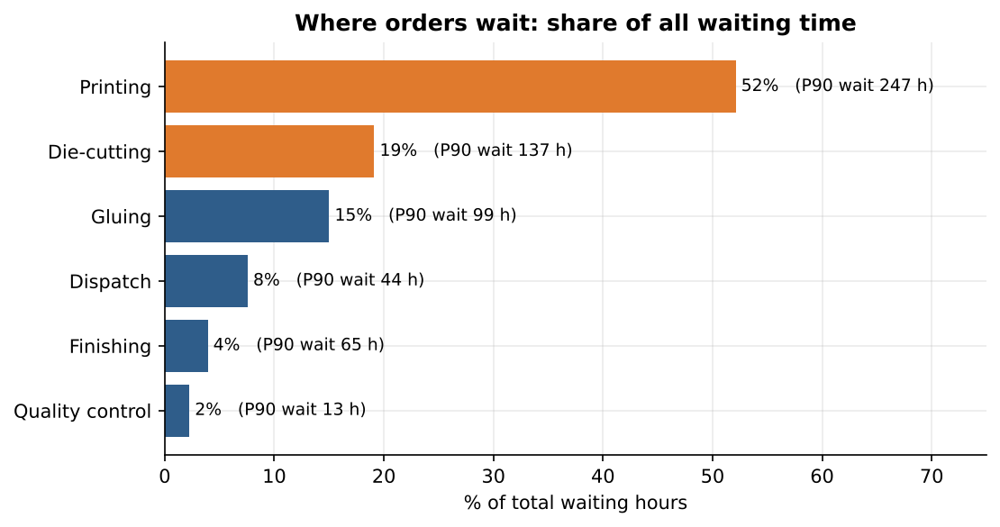

# Case 3 - Bottlenecks and delivery performance

> **Synthetic case.** OrygamiBox S.A. is a fictional folding-carton manufacturer. The data was generated with AI and contains deliberate errors, duplicates and missing values.

| | |
|---|---|
| **Problem** | Customers ask for shorter lead times and the company misses delivery dates without knowing at which stage orders get stuck. |
| **Question** | *"At which stage do orders fall behind, and what causes it?"* (asked by the operations manager) |
| **Finding** | **68%** of orders arrive on time (54% in Q4). Orders do not wait on the machines: they wait **between stages**, mostly in the **die-cutting queue**, and before printing. Late orders spend 2.8 more days waiting between stages than on-time ones, while machine downtime adds only 0.1 day. The real lead time is about 16 days whatever the order size, but promised dates range from 14 to 23 days, so **small orders are promised faster than the plant can deliver (30% on time)**. |
| **Recommendation** | Promise dates from real lead times (by order size, with a Q4 buffer), reduce the die-cutting queue, and record design and material times separately. |

**Tools:** BigQuery SQL (window functions `LAG`, `LEAD`, percentiles), Looker Studio dashboard, Python for charts.
**Statistics used:** percentiles (P50, P90), distribution of delays, comparison of groups, simple scenario.

## What I did

1. **Built the delivery KPIs per order** (`sql/01_order_delivery.sql`): promised days, lead time, days vs promise, on-time flag.
2. **Measured waiting and processing time for every stage** with `LAG()` over the stages of each order (`sql/02_stage_times.sql`).
3. **Found where time goes** with P50 and P90 per stage and each stage's share of all waiting (`sql/03_stage_percentiles.sql`).
4. **Compared late and on-time orders** by splitting their elapsed time into three parts, and checked how much machine downtime overlaps (`sql/04_delay_drivers.sql`).
5. **Checked materials and suppliers** (`sql/05_supplier_impact.sql`).
6. **Looked at seasonality and at the promises** (`sql/06_monthly_on_time.sql`, `sql/07_promise_vs_reality.sql`).
7. **Estimated an impact** with a simple scenario and said what it assumes.

## Key results

| Metric | Value |
|---|---|
| Orders delivered / on time | 1,135 / 68.5% |
| Average days late (late orders) | 4.0 |
| Lead time P50 / P90 | 16 / 22 days |
| On time in Q4 vs rest of year | 54% / 75% |
| Share of all waiting time: before printing / die-cutting / gluing | 52% / 19% / 15% |
| On time by order size (under 1,000 / 10,000+) | 30% / 92% |



## Files

| File | What it is |
|---|---|
| `report.md` | Report: method, findings, recommendations, limits |
| `sql/` | Seven BigQuery queries |
| `looker_studio/` | Dashboard preview, tables to connect, setup instructions |
| `analysis.py` | Same numbers in pandas, plus the charts |
| `charts/`, `results.json` | Charts and every number quoted in the report |

## How to reproduce

Load the tables in `data/clean/` into a BigQuery dataset called `orygamibox` (see `looker_studio/SETUP.md`) and run `sql/01` to `sql/07` in order. The pandas version:

```bash
python pipelines/clean_data.py
python case3_delivery/analysis.py
```
