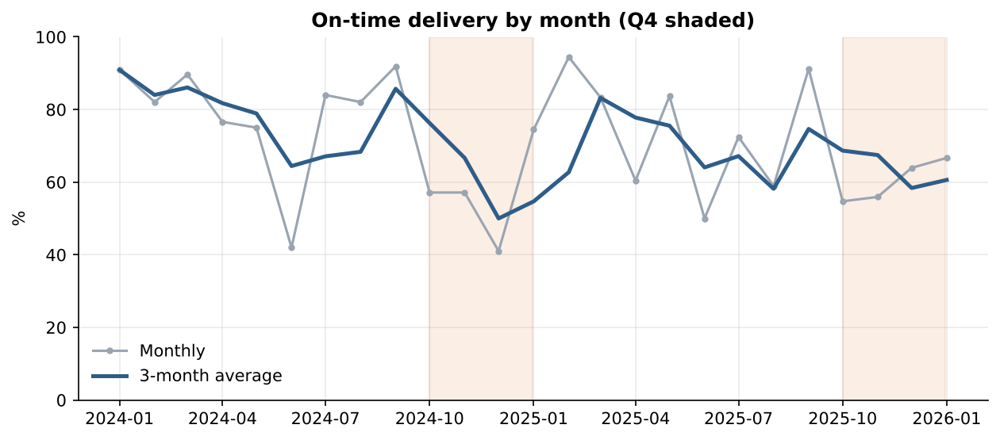
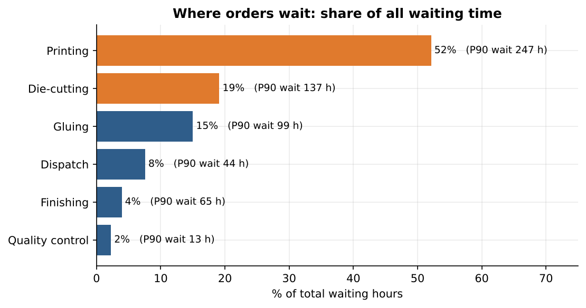
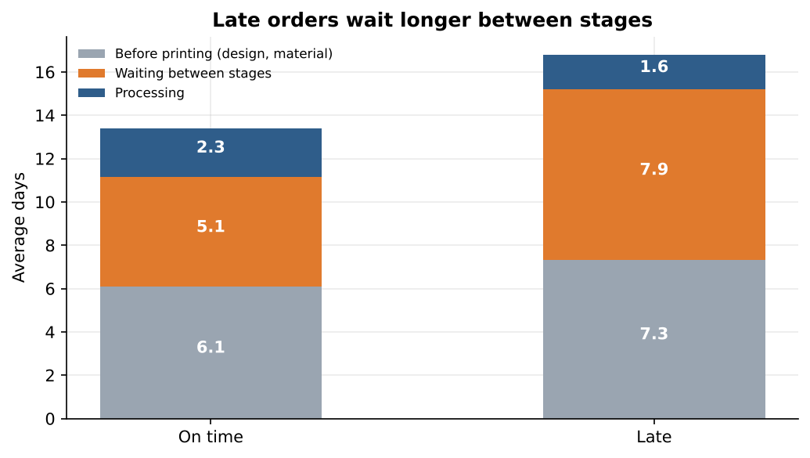
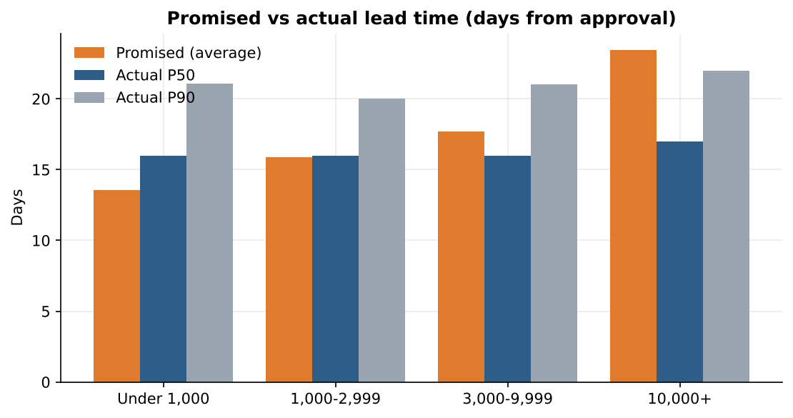
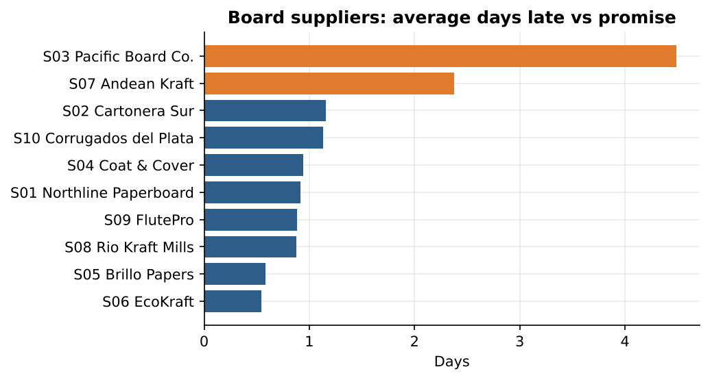

# Case 3 - Bottlenecks and delivery performance: report

*OrygamiBox S.A. (fictional company, synthetic data) - orders approved January 2024 to December 2025*

## 1. Context and question

Customers expect shorter delivery times. The operations manager knows many orders arrive late but does not know in which stage they lose time, so it is not clear where to act.

**Question:** at which stage do orders fall behind, and what causes it?

## 2. Data and cleaning

Tables: `orders`, `production_stages` (one row per order and stage, with start and end times), `machine_downtime`, `purchases` and `suppliers`. Cleaning was done in the pipeline shared by all cases (see `docs/cleaning_log.csv`). The issues that matter for this case:

| Table | Issue | Rows | Decision |
|---|---|---|---|
| production_stages | Duplicates, end earlier than start, mixed timestamp formats | 50 / 12 / 133 | Dropped / swapped / parsed |
| orders | delivered_date as DD/MM/YYYY | 32 | Parsed both formats |
| purchases | received_date as DD/MM/YYYY | 7 | Parsed both formats |
| machine_downtime | Missing or inconsistent cause | 17 / 15 | "Unknown" / standardised |

Delivery KPIs use the 1,135 orders that have a delivery date. An order is **on time** if it is delivered on or before the committed date.

## 3. Method

- **Waiting time** of a stage = its start minus the end of the previous stage (for the first stage, minus the approval date). **Processing time** = end minus start.
- Elapsed time of each order is split into three parts that add up: before printing (design, pre-press, waiting for material), waiting between stages, and processing. Machine downtime that overlaps those windows is reported separately.
- Percentiles (P50, P90) are used because waiting times are very skewed.

## 4. Findings

**1. 68% of orders arrive on time, and Q4 is much worse.** There are 358 late orders; a late order is 4.0 days late on average. Typical lead time is 16 days and 9 in 10 orders are done within 22. In Q4 only 54% are on time, against 75% in the rest of the year.

**2. Orders wait much more than they are worked on.** Processing is a small part of the time. Waiting between stages and before printing dominate. By share of all waiting time: before printing 52%, die-cutting 19%, gluing 15%.

| Stage | Wait P50 (hours) | Wait P90 (hours) | Process P50 (hours) | Share of waiting |
|---|---|---|---|---|
| Printing (from approval) | 139 | 247 | 3.0 | 52% |
| Die-cutting | 41 | 137 | 10.8 | 19% |
| Gluing | 34 | 99 | 3.2 | 15% |
| Dispatch | 18 | 44 | 14.3 | 8% |
| Finishing | 10 | 65 | 4.0 | 4% |
| Quality control | 5 | 13 | 1.0 | 2% |

The "before printing" wait includes design and pre-press time, which the data does not record separately. It cannot be split further.

**3. Die-cutting is the production bottleneck.** The two die-cutters are the busiest machines (54% and 61% of calendar time, against 32% for gluing and 12% or less for the others). Their P90 wait is 137 hours (almost 6 days). The longer an order waits at die-cutting, the later it is delivered (correlation 0.36).

**4. Late orders differ mainly in queue time, not in downtime.** On average:

| | Before printing | Between stages | Processing | Downtime overlapping |
|---|---|---|---|---|
| On time (777 orders) | 6.1 days | 5.1 days | 2.3 days | 0.32 days |
| Late (358 orders) | 7.3 days | 7.9 days | 1.6 days | 0.41 days |

Late orders wait 2.8 days more between stages and 1.2 days more before printing. Machine downtime adds only 0.1 day. Machines break down (3,669 downtime hours in two years, 44% of them breakdowns, mostly on Die-cutter B), but that is not what makes orders late.

**5. The promised dates do not match reality.** Real lead time is about 16 days (P50) for every order size, yet promised dates range from 14 to 23 days. Small orders are promised too fast and large orders too slow.

| Order size | Avg promised (days) | Actual P50 | Actual P90 | On time |
|---|---|---|---|---|
| Under 1,000 | 13.6 | 16 | 21 | 30% |
| 1,000-2,999 | 15.9 | 16 | 20 | 59% |
| 3,000-9,999 | 17.7 | 16 | 21 | 66% |
| 10,000+ | 23.5 | 17 | 22 | 92% |

**6. Materials have a small effect, concentrated in two suppliers.** 23% of orders trigger a purchase of board and wait 9.2 days before printing, against 5.6 days for the rest. Their on-time rate is 65% against 69%. Pacific Board Co. (S03) delivers 4.5 days later than promised on average and Andean Kraft (S07) 2.4 days, against 0.5 to 1.2 for the others. The orders waiting for them are on time 58% and 50% of the time. These groups are small (26 and 28 orders), so treat them as a lead, not a conclusion.

## 5. Recommendations

| # | Recommendation | Why | Estimated impact | Effort |
|---|---|---|---|---|
| 1 | **Promise dates from data.** Use the real P75 lead time by order size (about 18 to 21 days) and add a buffer in Q4. | Promises ignore real lead times; the smallest orders are on time only 30% of the time. | Makes promises reliable. It does not make production faster, so it should go together with 2. | Low |
| 2 | **Reduce the die-cutting queue.** Sequence jobs by due date and die, add overtime in Q4, and keep maintenance on Die-cutter B (most downtime) outside peak weeks. | Biggest queue in production, and the one most related to lateness. | Scenario: if the die-cutting queue were halved, on-time delivery would go from **68% to 74%** (68 late orders recovered). | Medium |
| 3 | **Record design / pre-press start and end** separately from material arrival. | 52% of all waiting is before printing and cannot be explained with the current data. | Makes the next analysis possible. | Low |
| 4 | **Set a safety stock** for the board that triggers most purchases, and review the two late suppliers. | 23% of orders wait for material; S03 and S07 deliver late. | Not quantified (small sample). | Medium |

## 6. Limitations and next steps

- The scenario in recommendation 2 assumes that the saved time passes straight to the delivery date and that nothing else changes downstream. It is an estimate.
- Supplier results come from 21 to 34 orders per supplier.
- The data is synthetic, so the numbers show the method, not a real plant.
- Next step: use this lead-time view with the cost view in Case 4 to see which clients are both late and unprofitable.
