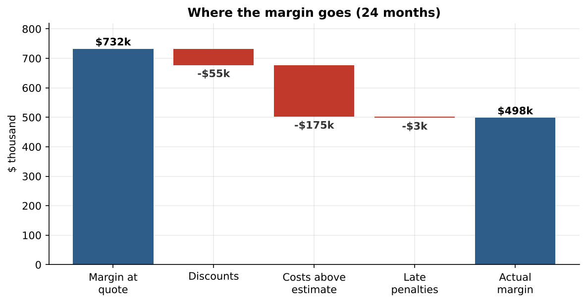

# Case 4 - Profitability by client

> **Synthetic case.** OrygamiBox S.A. is a fictional folding-carton manufacturer. The data was generated with AI and contains deliberate errors, duplicates and missing values.

| | |
|---|---|
| **Problem** | The company tracks sales volume, but not how much each client really leaves after material, scrap, machine time and discounts. |
| **Question** | *"Which clients leave us real margin and which ones cost more than they seem?"* (asked by the general manager) |
| **Finding** | Revenue was **$3.98M** with a **12.5%** margin ($499k). The **5 large clients bring 55% of revenue but only 36% of margin** (8.4% margin, against 16.4% for medium and 21.7% for small clients). The bigger the client, the lower the margin %. The biggest leak is **costs above the quoted estimate ($175k)**, followed by discounts ($55k). Late penalties are almost nothing ($3k). |
| **Recommendation** | Reprice or reduce discounts for the large accounts (a 3% increase pays off unless it costs more than 26% of their volume), correct the cost estimates, and protect the small and medium clients, which are the most profitable. |

**Tools:** Python (pandas) to consolidate tables, BigQuery SQL (window functions, `ROLLUP`) for the final model, Looker Studio dashboard.
**Statistics used:** correlation (Pearson and Spearman), Pareto / ABC analysis, margin bridge, sensitivity scenario.

## What I did

1. **Consolidated six tables into one fact table** with one row per order (`consolidate.py`): revenue, every cost component, margin, discount, scrap cost.
2. **Defined margin clearly:** final price minus material, consumables, machine time, labour, logistics, tooling and late penalties. It is a contribution margin (no overhead).
3. **Ranked clients** by revenue, margin and margin % with `RANK()`, and measured concentration with a running `SUM() OVER` (`sql/01`, `sql/02`).
4. **Built a margin bridge:** margin promised in the quote -> discounts -> costs above estimate -> penalties -> actual margin (`sql/03`).
5. **Compared segments:** client size, sector, order size, finish, and a four-group split of clients by margin % with `NTILE` (`sql/04`, `sql/05`, `sql/06`).
6. **Tested the link between size and margin** with correlations, and checked it two ways (clients and orders).
7. **Ran a sensitivity scenario** for repricing the large accounts and found the point where it stops paying off.

## Key results

| Client size | Clients | Share of revenue | Share of margin | Margin % |
|---|---|---|---|---|
| Large | 5 | 55% | 36% | 8.4% |
| Medium | 19 | 35% | 45% | 16.4% |
| Small | 36 | 11% | 18% | 21.7% |



## Files

| File | What it is |
|---|---|
| `report.md` | Report: method, findings, recommendations, limits |
| `consolidate.py` | Builds `fact_orders` (one row per order) |
| `sql/` | Six BigQuery queries on `fact_orders` |
| `looker_studio/` | Dashboard preview, tables to connect, setup instructions |
| `analysis.py` | Same numbers in pandas, plus the charts |
| `charts/`, `results.json` | Charts and every number quoted in the report |

## How to reproduce

```bash
python pipelines/clean_data.py
python case4_profitability/consolidate.py     # creates data/clean/fact_orders.csv
python case4_profitability/analysis.py
```
Load `data/clean/fact_orders.csv` into BigQuery as `orygamibox.fact_orders` and run the files in `sql/` (see `looker_studio/SETUP.md`).
