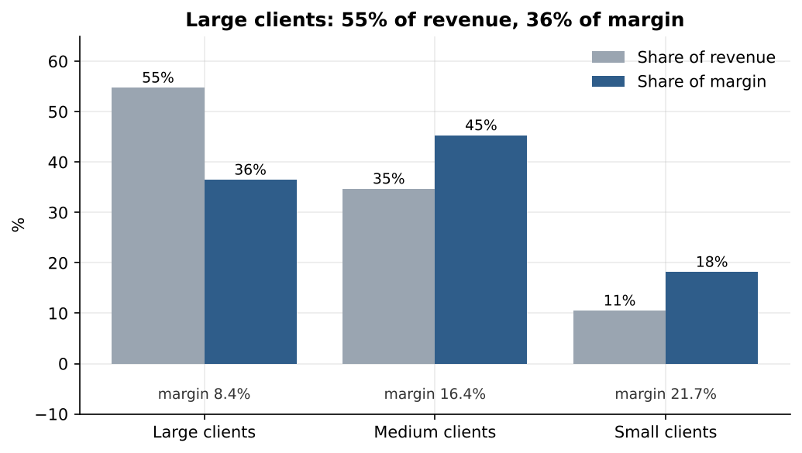
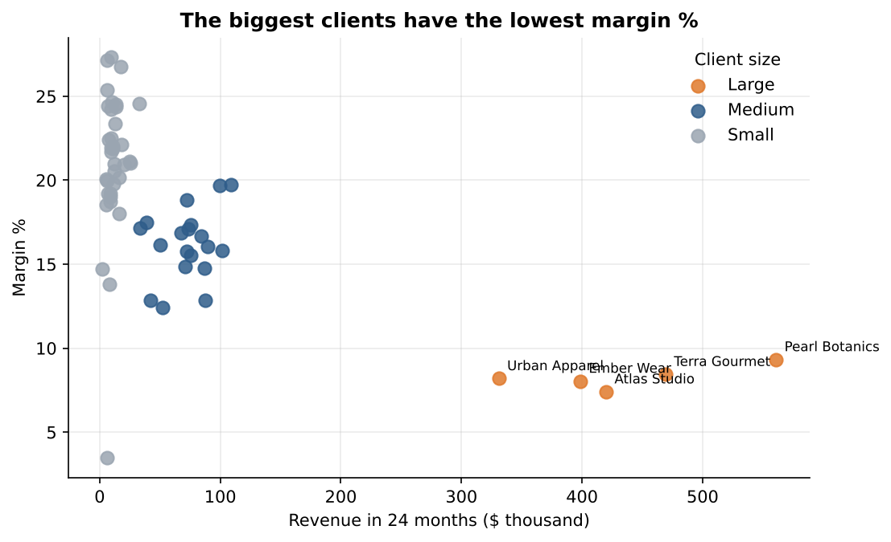
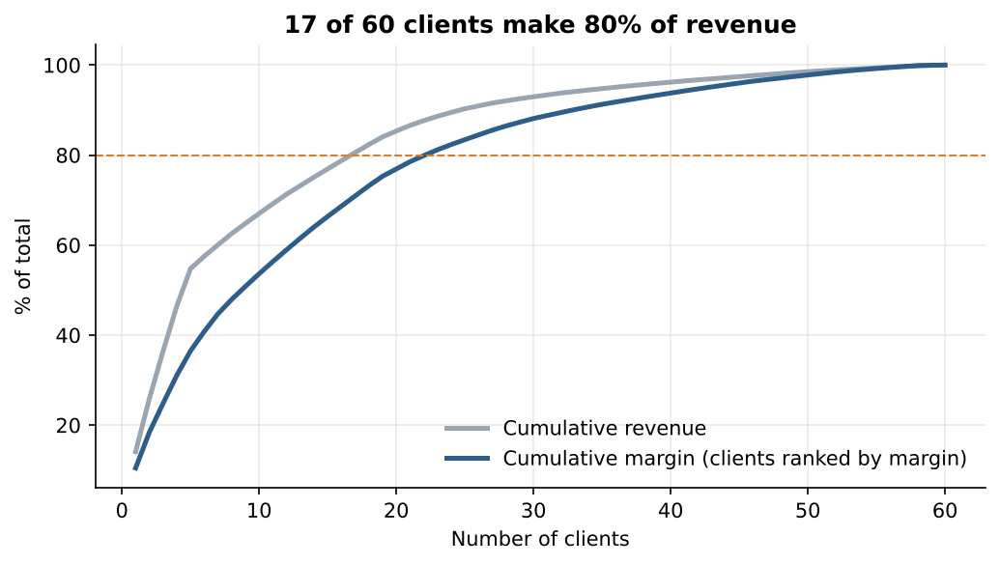
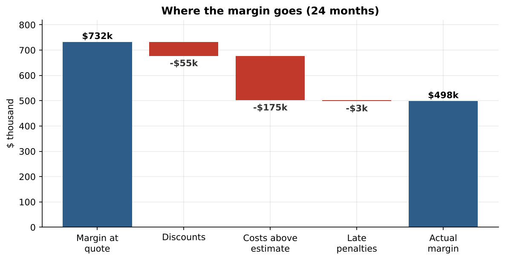
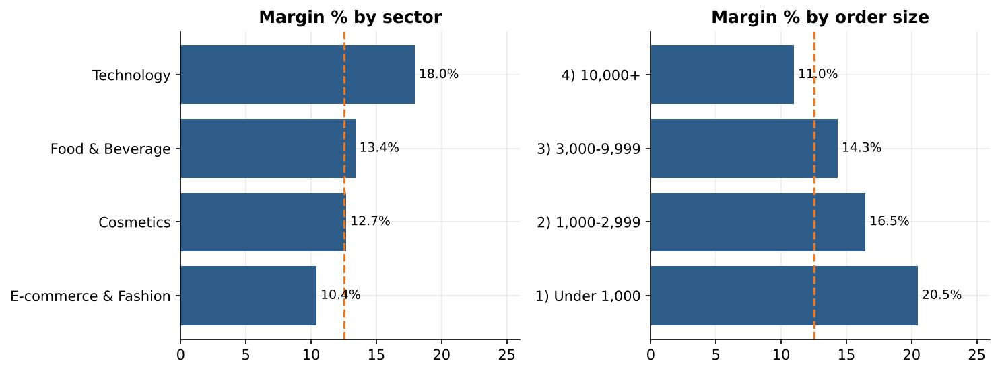
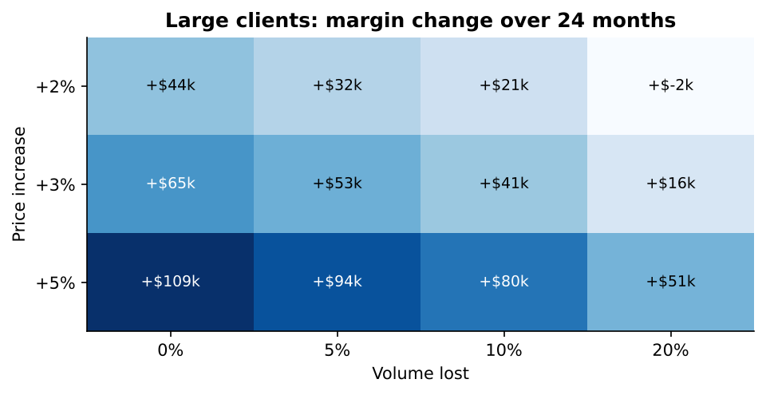

# Case 4 - Profitability by client: report

*OrygamiBox S.A. (fictional company, synthetic data) - orders approved January 2024 to December 2025*

## 1. Context and question

The company has grown by winning large orders and tracks sales volume. The general manager suspects that some of the biggest accounts are not as profitable as they look.

**Question:** which clients leave real margin and which ones cost more than they seem?

## 2. Data and definitions

This case builds on the other three: it joins `orders`, `order_costs`, `quotes`, `clients` and `production_stages` (cleaned in the shared pipeline) into one table with one row per order (`consolidate.py`): 1,135 orders and 60 clients.

**Margin** = final price - (material + consumables + machine time + labour + logistics + tooling + late penalties). It is a *contribution margin*: it does not include rent, administration or other overhead. Machine and labour costs come from the hours each order really used.

Data issues: labour cost was missing on 20 orders and logistics cost on 32; both were estimated (a ratio to machine cost, and a straight-line fit on quantity; see the cleaning log). About 1% of orders have no cost estimate in the quote and are left out of the margin bridge only.

## 3. Findings

**1. Revenue $3.98M, margin $499k (12.5%).** Material is the largest cost (42%), followed by machine time (26%) and labour (18%).

**2. Large clients bring volume, not margin.** The five large clients are 55% of revenue but 36% of margin.

| Client size | Clients | Revenue share | Margin share | Margin % |
|---|---|---|---|---|
| Large | 5 | 55% | 36% | 8.4% |
| Medium | 19 | 35% | 45% | 16.4% |
| Small | 36 | 11% | 18% | 21.7% |

**3. The relationship is consistent, not a coincidence of a few accounts.** At client level the correlation between revenue and margin % is -0.65 (Spearman -0.53). Between order size and margin % it is -0.34 over 1,135 orders. Margin % falls from 20.5% in orders under 1,000 units to 11.0% in orders over 10,000.

**4. Concentration.** 17 of 60 clients make 80% of revenue (class A in an ABC analysis). They give 71% of margin at 11.0%, while the 43 smaller clients (classes B and C) give 29% of margin from 19% of revenue. The top five clients alone are 55% of revenue. This also means a dependency: any change in price for them must be handled with care.

**5. Where the margin goes.** Quotes promise $732k of margin, but the company keeps $498k (1,120 orders with an estimate). The leaks are:

| Step | Amount | Share of revenue |
|---|---|---|
| Margin promised in quotes | $732k | |
| Discounts | -$55k | 1.4% |
| Costs above the estimate | **-$175k** | **4.5%** |
| of which board (scrap and overage above the 5% allowance) | -$53k | |
| of which machine time, labour and other | -$122k | |
| Late penalties | -$3k | 0.1% |
| **Actual margin** | **$498k** | |

Costs above the estimate are the biggest leak, more than three times the discounts. Late penalties are only 59 orders and 0.1% of costs, so they are not a priority.

**6. Why the large clients earn less.** They are quoted a lower markup (1.17 on the estimated cost, against 1.37 for small clients) and get larger discounts (1.8% on average against 1.2-1.3%). They also absorb the same cost overruns, so a thin margin leaves little room.

**7. Other segments.** Technology has the best margin (18.0%) and e-commerce the worst (10.4%), but e-commerce is 39% of revenue and three of the five large clients are in it. 15% of orders earn less than 5% and 7% lose money.

## 4. Recommendations

| # | Recommendation | Why | Estimated impact | Effort |
|---|---|---|---|---|
| 1 | **Reprice the large accounts, or reduce their discounts**, gradually and account by account. | 55% of revenue at 8.4% margin; lowest markup and largest discounts. | Scenario: +3% on their prices adds **$41k to $65k** over 24 months if they lose 0-10% of volume. It breaks even if they cut volume by 26%. | Medium |
| 2 | **Update the cost estimates:** scrap allowance by order size and finish (Case 1) and real machine-time standards. | Costs above the estimate are $175k, 4.5% of revenue. | Part of the $175k can be recovered through quotes. Not quantified. | Low |
| 3 | **Protect and grow the small and medium clients.** Fast answers to their quotes (Case 2). | Margin 16-22%, and their quote win rates are the lowest (31% for small clients). | Not quantified. | Low |
| 4 | **Require approval for orders with an expected margin under 5%.** | 15% of orders are below 5%; 7% lose money. | Not quantified. | Low |
| 5 | **Do not prioritise penalties.** | $3k in two years. | None. | None |

Sensitivity of recommendation 1 (margin change for the five large clients, 24 months):

| Price increase \ volume lost | 0% | 5% | 10% | 20% |
|---|---|---|---|---|
| +2% | +$44k | +$32k | +$21k | -$2k |
| +3% | +$65k | +$53k | +$41k | +$16k |
| +5% | +$109k | +$94k | +$80k | +$51k |

## 5. Limitations and next steps

- Margins are contribution margins: overhead is not included, so real profit is lower.
- The scenario assumes volume loss is the only reaction to a price increase. Case 2 shows that price matters for new quotes; whether it matters as much for existing contracts is unknown. Test it on the least profitable account first.
- Only five large clients drive the result, so the conclusion rests on a small group, although the pattern also appears across all 60 clients and 1,135 orders.
- The data is synthetic, so the numbers show the method, not a real company.
- Next step: monitor margin % by client every month with this dashboard, and review the large accounts quarterly.
